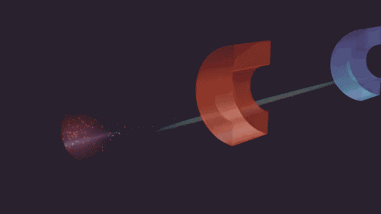
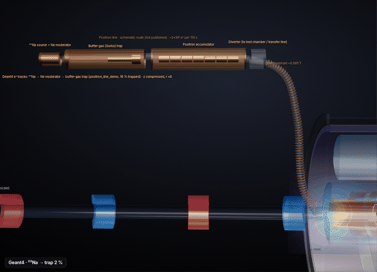

# AEgIS Digital Twin: interactive showcase

   
  <em>Story mode: p̄ transfer line, 5 T / 1 T solenoids with field lines and |B| map, electrode potentials, transport and annihilation.</em>

   
  <em>Positron line: Geant4 e⁺ from the ²²Na source and solid-neon moderator into the buffer-gas trap, then the bunch from the accumulator down the guide solenoid into the 5 T line.</em>

**Live:** https://bharat-singh-rawat.github.io/AEgIS_Digital_Twin/

A read-only, in-browser showcase of the AEgIS Penning–Malmberg trap digital twin. It shows G4beamline 3.08
simulations in the CST frame with reduced-order-model magnetic and electric fields:

- **Event Display:** a 3D WebGL view of the electrode stack, solenoids, degrader and scintillators, with every
  recorded particle track (p̄, π±, γ, e±, …) animated in time. It includes a guided story mode and GIF export.
- **Results and Physics:** annihilation vertices, hits per electrode, scintillator response, spectra and
  multiplicities.
- **Magnets and Electrodes:** live on-axis B(z), Φ(z) and Ez(z) from the ROM unit bases (23 coils, 66 electrodes).

Everything runs client-side from pre-exported JSON (`api/`). Simulations themselves run offline.
This folder is generated by `export_static.py` in the digital-twin source; don't edit it by hand.

© Bharat Singh Rawat. All rights reserved.
